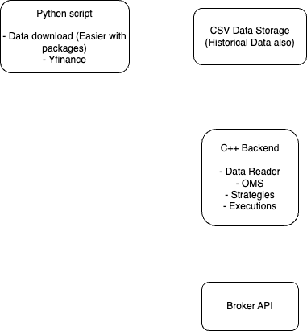

# C++ Algorithmic Trading System

A modern C++ framework for algorithmic trading, backtesting strategies, and live trading.

## **Building the Project**

### Prerequisites
- CMake 3.3 or higher
- C++23 compatible compiler
- nlohmann_json library (automatically fetched)
- GoogleTest (automatically fetched)

### To Build
```sh
# Create a build directory
mkdir -p build
cd build

# Configure the project
cmake ..

# Build
make -j4
```

### To Run (live, Alpaca)
The trading app now streams real-time 1-minute bars from Alpaca and sends orders to Alpaca's API.
No CSV files or broker desktop app are needed.

1. Create a free account at [alpaca.markets](https://alpaca.markets) and generate **paper trading** API keys.
2. Put the keys in a `.env` file in the project root (git ignores it, so they never get committed):
   ```sh
   cp .env.example .env
   # then edit .env and paste in your key id and secret
   ```
   A variable already exported in your shell takes priority over `.env`.
3. Build and run from the project root:
   ```sh
   ./build_run.sh
   ```
   Stop it with `Ctrl+C`.

Settings live in the `"alpaca"` block of `src/config/config.json`:

| Key | Meaning |
|---|---|
| `data_feed` | `"iex"` free real-time feed, `"sip"` all exchanges (paid plan), `"test"` fake symbol FAKEPACA that streams 24/7 for checking the wiring (orders are only printed) |
| `trading_url` | `https://paper-api.alpaca.markets` (paper) or `https://api.alpaca.markets` (real money) |
| `dry_run` | `true` prints orders instead of sending them |
| `warmup_bars` | Recent bars loaded at start-up so strategies have history straight away |
| `max_bars` | How many recent bars to keep in memory |

Outside US market hours, set `"data_feed": "test"` to see bars flowing.

#### Saved state and P&L
While running, the app saves its state to `data/live/` (`data/live_dry_run/` for dry runs). The files are only written while running and only read once at start-up, so they never slow down a decision:

| File | Contents |
|---|---|
| `trades.csv` | Every order sent, one line each (bar time, type, quantity, price, stop loss, take profit) |
| `positions.csv` | Current positions, rewritten when they change |
| `performance.json` | Latest P&L snapshot: realised / unrealised P&L, ROI, drawdown, Sharpe, win rate |

On the next start the trades are replayed, so P&L and order numbering carry on. Each bar the app also checks
its position with Alpaca; if Alpaca filled a stop loss or take profit by itself, the difference is recorded as a
trade at that bar's close. Live P&L uses the bar close as the fill price, so it's a close estimate rather than
Alpaca's exact fills. ROI is measured against `"starting_capital"` in the config.
See [doc/realtime_data_and_brokers.md](doc/realtime_data_and_brokers.md) for why Alpaca, prices and speeds.

On macOS the WebSocket library uses Apple's built-in TLS, so there is nothing extra to install.
On Linux install OpenSSL headers first (`sudo apt install libssl-dev`).

### To Run Backtester
```sh
# Run from the project root directory
./build_run_backtest.sh --start-date 2026-10-01 --end-date 2026-10-28 --download
```
`--download` fetches any days in the range that aren't already in `data/` from Alpaca first
(uses the keys in `.env`). Use `--download-only` to just fetch data. One CSV per trading day is saved as
`data/marketData_<TICKER>_<YYYY-MM-DD>.csv`, in New York exchange time, regular hours only.

By default history comes from Alpaca's `sip` feed (all US exchanges, free for data older than 15 minutes).
Set `"history_feed": "iex"` in the `"alpaca"` config block to match the free live stream instead.

### Running Tests
```sh
# From the build directory
ctest
# or
make test
```
Individual test executables are located in subdirectories:
```
./build/tests/data_access_tests/data_access_tests
./build/tests/oms_tests/oms_tests
./build/tests/strategy_tests/strategy_tests
./build/tests/broker_tests/broker_tests
./build/tests/backtest_tests/backtest_tests
./build/tests/util_tests/util_tests
./build/tests/alpaca_tests/alpaca_tests
./build/tests/regression_tests/regression_tests
```

`regression_tests` runs the whole backtest and the live decision path on a fixed price series and checks the
results haven't changed. If you change behaviour on purpose (e.g. tune a strategy), it prints the new values
on a `REGRESSION VALUES` line; copy them into `tests/regression_tests/Tests_Regression.cpp`.

### To Debug Crash
```sh
lldb ./build/app/algo_trader_app
run
bt
```

## **Architecture**  

### **System Overview**  
<details>
  <summary>View Diagram</summary>

    

</details>  

The **System Overview** provides a high-level architecture of the trading platform. It includes:  
- **Live Data** (Alpaca WebSocket pushes a 1-minute bar the moment each minute closes, `src/alpaca/AlpacaStream`)  
- **Historical Data** (downloaded from Alpaca into CSV files in `data/`, used by the backtester)  
- **C++ Backend** (Processes data, runs strategies, and manages orders)  
- **Broker API Integration** (Alpaca REST API executes trades, `src/alpaca/AlpacaBroker`)  

Live flow, all in one process:
```
Alpaca WebSocket --(bar)--> MarketData --> Strategies (RSI/MACD/MEANREV) --(signal)--> OMS --> Alpaca REST order
```

---

### **Data Reader**  
<details>
  <summary>View Diagram</summary>

    

</details>  

The **Data Reader** is responsible for:  
- Reading market data from CSV files  
- Parsing and structuring the data for the trading system  
- Feeding the data into the **Strategy Engine** for signal generation  

---

### **Data Flow**  
<details>
  <summary>View Diagram</summary>

    

</details>  

The **Data Flow** diagram illustrates how data moves through the system when **backtesting**:  
1. **`backtest_app --download` fetches 1-minute bars from Alpaca** and saves one CSV per day in `data/`  
2. **C++ reads the CSV** and processes market conditions  
3. **Strategies analyze the data** and generate trading signals  
4. **Orders are sent to the OMS**, which manages execution via the simulated broker  

When trading **live**, steps 1 and 2 are replaced by the Alpaca WebSocket stream and orders go to Alpaca (see System Overview).  

---

### **Order Management System (OMS)**  
<details>
  <summary>View Diagram</summary>

    

</details>  

The **Order Management System (OMS)** handles:  
- Storing open **orders** (buy/sell requests)  
- Tracking **positions** (executed orders)  
- Communicating with the broker API for order execution  
- Managing order status updates (e.g., filled, canceled)  

---

### **Strategy Engine**  
<details>
  <summary>View Diagram</summary>

    

</details>  

The **Strategy Engine** is the core of trade decision-making:  
- Receives **market data** and analyzes trading conditions  
- Runs **trading strategies** (e.g., Moving Average Crossover, RSI)  
- Generates **trade signals** (buy/sell orders)  
- Sends orders to the OMS for execution  

---

### **Backtest Engine**  
<details>
  <summary>View Diagram</summary>

    

</details>  

The **Backtest Engine** allows testing strategies on historical data:  
- **Simulates market conditions** by feeding past data to strategies  
- **Executes trades** as if they were placed in real-time  
- **Evaluates strategy performance** using metrics like win/loss ratio, Sharpe ratio, and drawdown  
- Helps refine trading algorithms before live deployment