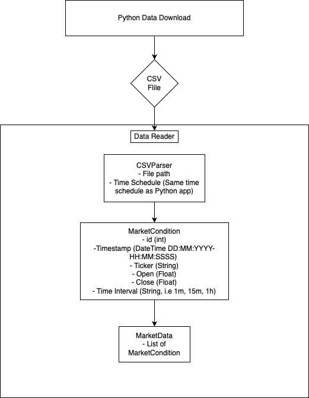
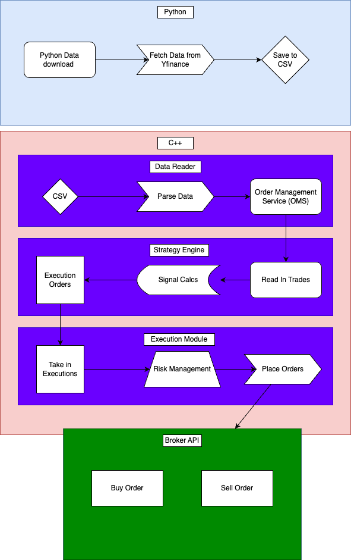
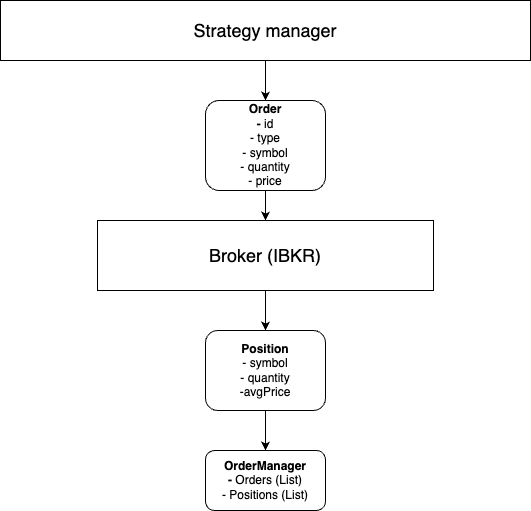
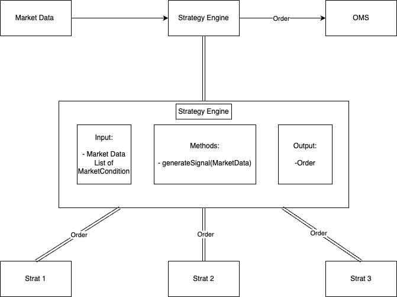
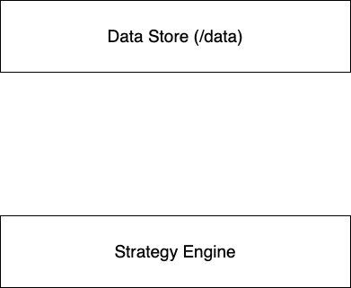

# C++ Algorithmic Trading System

A modern C++ framework for algorithmic trading, backtesting strategies, and live trading.

## **Building the Project**

### Prerequisites
- CMake 3.3 or higher
- C++23 compatible compiler
- nlohmann_json library (automatically fetched)
- GoogleTest (automatically fetched)

### To Build
```sh
# Create a build directory
mkdir -p build
cd build

# Configure the project
cmake ..

# Build
make -j4
```

### Config

Settings are in `config/` in the project root (next to `data/`). The app reads the first three as one config,
so each setting lives in exactly one of them:

| File | What's in it |
|---|---|
| `general.json` | data folder, starting capital, data size limit, the `"alpaca"` block |
| `strategy.json` | the `"portfolio"`: each stock and its strategies (strategies are only set per stock) |
| `risk.json` | the `"risk"` engine (position sizing), order limits, and `risk_app`'s comparison and tuning grids |
| `screen.json` | `screen_app`'s stocks, dates and strategy grids |
| `optimisation.json` | `optimise_app`'s strategy grids |

### To Run (live, Alpaca)
The trading app now streams real-time 1-minute bars from Alpaca and sends orders to Alpaca's API.
No CSV files or broker desktop app are needed.

1. Create a free account at [alpaca.markets](https://alpaca.markets) and generate **paper trading** API keys.
2. Put the keys in a `.env` file in the project root (git ignores it, so they never get committed):
   ```sh
   cp .env.example .env
   # then edit .env and paste in your key id and secret
   ```
   A variable already exported in your shell takes priority over `.env`.
3. Build and run from the project root:
   ```sh
   ./build_run.sh
   ```
   Stop it with `Ctrl+C`.

Settings live in the `"alpaca"` block of `config/general.json`:

| Key | Meaning |
|---|---|
| `data_feed` | `"iex"` free real-time feed, `"sip"` all exchanges (paid plan), `"test"` fake symbol FAKEPACA that streams 24/7 for checking the wiring (orders are only printed) |
| `trading_url` | `https://paper-api.alpaca.markets` (paper) or `https://api.alpaca.markets` (real money) |
| `dry_run` | `true` prints orders instead of sending them |

At start-up the app back-fills exactly the bars the active strategies need (the largest of: RSI `period`, MEANREV `lookback_period`/`moving_average_period`, MACD `5 × (long_period + signal_period)`) and keeps that many in memory, so every strategy decides from the first live bar.

It then prints one summary of what it's about to do: the mode (paper, real money, dry run or backtest), the
account's cash and buying power, when the market opens or closes, where the bars come from, the risk engine and
its settings, the records restored from the last run, and a table of each stock's strategy, stop, target,
settings and back-filled bars. Add `--verbose` to also see each step (config files read, connections made,
bars back-filled).

Outside US market hours, set `"data_feed": "test"` to see bars flowing.

#### Backtest: run the whole app on past days
Run the same app, with the same portfolio, strategies, risk engine, OMS and per-minute table, on saved 1-minute
bars instead of Alpaca's stream, with a simulated broker filling the orders and running stop losses / take profits:

```sh
./build/app/algo_trader_app --backtest                     # the latest day saved for every portfolio stock
./build/app/algo_trader_app --backtest 2026-10-15 --days 3 # three trading days from 15 Oct
./build/app/algo_trader_app --backtest 2026-10-01 --days 31 --capital 25000   # starting with $25,000
./build/app/algo_trader_app --backtest --speed 60          # 60 minutes a second, to watch it (default 0: as fast as possible)
./build/app/algo_trader_app --backtest 2025-11-03 --days 250 --quiet   # just the recap
```

Nothing is sent to Alpaca. Bars for the chosen days (and the few days before, which the strategies warm up on)
that aren't saved yet are downloaded first into `data/minute/<TICKER>/`, using the keys in `.env`. Fills are at
each bar's close with 0.01% slippage against us (`"backtest_slippage_percent"` in config/general.json), and every
sell pays the SEC and FINRA fees Alpaca passes on (`"regulatory_fees"`, same file; Alpaca charges no commission). Records go to
`data/backtest/<day>/` (fresh each run), so `data/live/` and the paper account are untouched. At the end it
prints the simulated equity, P&L, fills per stock and the most capital in use.

#### Stocks and strategies (`"portfolio"`)
The `"portfolio"` list in `config/strategy.json` is what the app trades: every stock in it at once, each with
its own strategy and settings, from a single Alpaca stream. There are no default strategies; each stock sets
its own:

```json
"portfolio": [
    {"ticker": "TXN", "strategy": {"name": "MEANREV", "lookback_period": 60, "moving_average_period": 60,
                                   "entry_threshold": 3.0, "exit_threshold": 0.0, "stop_loss": 1, "take_profit": 2}},
    {"ticker": "WMT", "strategies": [{"name": "RSI", "period": 45, "overbought_threshold": 80,
                                      "oversold_threshold": 25, "stop_loss": 5, "take_profit": 5}]}
]
```

The format is the same as `data/screen/minute/top_picks_config.json` from `screen_app`, so the screen's picks
can be pasted in as they are. Each stock gets its own price history, back-fill and strategies; one OMS, one
`trades.csv` and one P&L book cover them all, and `max_position_size` applies per stock.

#### Saved state and P&L
While running, the app saves its state to `data/live/` (`data/live_dry_run/` for dry runs). The files are only written while running and only read once at start-up, so they never slow down a decision:

| File | Contents |
|---|---|
| `trades.csv` | Every order the strategies produced, one line each, whatever happened to it (see below) |
| `positions.csv` | Current positions, rewritten when they change |
| `performance.json` | Latest snapshot: `alpaca` = Alpaca's real equity, today's P&L and position (unrealised P&L from real fills and Alpaca's latest price); `estimate` = our own book (realised / unrealised P&L, ROI, drawdown, Sharpe, win rate) |

`trades.csv` columns:

| Column | Meaning |
|---|---|
| `our_id` | Our order number. Every attempt gets one, and numbering carries on after a restart |
| `time` | Bar the decision was made on (New York time) |
| `sent_at_utc` | Wall-clock time the order was sent, to the millisecond |
| `strategy` | Strategy that produced it (`RSI+MACD` if several agreed, `broker` for adjustments) |
| `ticker`, `side`, `type`, `order_class` | e.g. `NVDA`, `buy`, `BUY`, `bracket` |
| `quantity`, `price` | Price is the bar close when decided (an estimate of the fill) |
| `stop_loss`, `take_profit` | Bracket prices sent with the order |
| `status` | `sent`, `rejected` (by Alpaca), `blocked` (by our risk checks), `adjustment`, `dry_run` |
| `broker_status` | Alpaca's own status, e.g. `accepted` |
| `client_order_id` | Our id as sent to Alpaca, e.g. `algo-12-1793300000`: search for it on Alpaca's dashboard |
| `broker_order_id` | Alpaca's id for the order |
| `round_trip_ms` | Time to send the order and get Alpaca's reply |
| `note` | Why it was blocked/rejected, or why an adjustment was made |

Lines are written by a background thread after the order has gone out, so saving never delays an order.

On the next start the trades are replayed, so P&L and order numbering carry on. Each bar the app also checks
its position with Alpaca; if Alpaca filled a stop loss or take profit by itself, the difference is recorded as a
trade at that bar's close. After every bar the app prints one `P&L:` line straight from Alpaca: equity, today's P&L, the position
and its unrealised P&L. Our own book (which assumes fills at bar closes and feeds drawdown / Sharpe /
win rate) is saved in `performance.json` under `estimate`; it's only printed in dry runs, where Alpaca
isn't holding the trades. ROI is measured against `"starting_capital"` in the config.
See [doc/realtime_data_and_brokers.md](doc/realtime_data_and_brokers.md) for why Alpaca, prices and speeds.

On macOS the WebSocket library uses Apple's built-in TLS, so there is nothing extra to install.
On Linux install OpenSSL headers first (`sudo apt install libssl-dev`).

### To build, test and backtest in one go
```sh
# Run from the project root directory
./build_run_backtest.sh 2026-10-01 --days 20
```
Builds, runs the tests, then runs `algo_trader_app --backtest` with whatever follows (here 20 trading days from
1 Oct 2026). Missing days are downloaded first. One CSV per trading day is saved as
`data/minute/<TICKER>/marketData_<TICKER>_<YYYY-MM-DD>.csv`, in New York exchange time, regular hours only.

By default history comes from Alpaca's `sip` feed (all US exchanges, free for data older than 15 minutes).
Set `"history_feed": "iex"` in the `"alpaca"` config block to match the free live stream instead.

### Dashboard
A web page over the trader's records, with Start, Stop and Flatten: live P&L, positions, the tape of orders,
strategy levels, backtest vs live for a traded day, and the history of every day.

```sh
# First time
conda create -n algotrader python=3.13 -y
conda activate algotrader
python -m pip install -r dashboard/requirements.txt

./run_dashboard.sh        # then open http://127.0.0.1:8050 (this computer only)
python -m pytest -q dashboard/tests
```
The trader doesn't need it: every app still runs from the command line, and a trader started from the
dashboard keeps running if the dashboard is closed.

### CI and the home server
GitHub Actions builds and tests everything on every push (`.github/workflows/ci.yml`). Once CI passes on
`main`, `.github/workflows/deploy.yml` deploys to the home server's container through a self-hosted runner:
it builds the apps there and restarts the dashboard (port 8050). One-off server setup:
[deploy/README.md](deploy/README.md).

---

### **Data Reader**  
<details>
  <summary>View Diagram</summary>

    

</details>  

The **Data Reader** is responsible for:  
- Reading market data from CSV files  
- Parsing and structuring the data for the trading system  
- Feeding the data into the **Strategy Engine** for signal generation  

---

### **Data Flow**  
<details>
  <summary>View Diagram</summary>

    

</details>  

The **Data Flow** diagram illustrates how data moves through the system when **backtesting**:  
1. **`algo_trader_app --backtest` downloads any missing 1-minute bars from Alpaca** (one CSV per day in `data/minute/<TICKER>/`)  
2. **C++ reads the CSV** and processes market conditions  
3. **Strategies analyze the data** and generate trading signals  
4. **Orders are sent to the OMS**, which manages execution via the simulated broker  

When trading **live**, steps 1 and 2 are replaced by the Alpaca WebSocket stream and orders go to Alpaca (see System Overview).  

---

### **Order Management System (OMS)**  
<details>
  <summary>View Diagram</summary>

    

</details>  

The **Order Management System (OMS)** handles:  
- Storing open **orders** (buy/sell requests)  
- Tracking **positions** (executed orders)  
- Communicating with the broker API for order execution  
- Managing order status updates (e.g., filled, canceled)  

---

### **Strategy Engine**  
<details>
  <summary>View Diagram</summary>

    

</details>  

The **Strategy Engine** is the core of trade decision-making:  
- Receives **market data** and analyzes trading conditions  
- Runs **trading strategies**: RSI, MACD, MEANREV (mean reversion to a moving average) and SCALP (below)  
- Generates **trade signals** (buy/sell orders)  
- Sends orders to the OMS for execution  

**SCALP** is a VWAP fade scalper for 1-minute bars. It tracks today's volume-weighted average price (VWAP, from
the 09:30 open) and bands `entry_threshold` standard deviations either side of it. When the price stretches
outside a band it trades back towards the VWAP (sell above, buy below), and closes when the price is back
within `exit_threshold` standard deviations of the VWAP, after `max_hold_bars` bars at most, or at 15:55,
whichever comes first, so it is always flat overnight. No new trades for `warmup_minutes` after the open or
after 15:45. Each entry has a tight `stop_loss` / `take_profit` in % (e.g. 0.3 / 1) that the broker manages;
SCALP follows the real position, so a trade the broker's stop closed isn't "exited" again.

```json
{"name": "SCALP", "active": 1, "entry_threshold": 2.0, "exit_threshold": 0.0, "max_hold_bars": 10,
 "warmup_minutes": 15, "stop_loss": 0.3, "take_profit": 1.0}
```

It is in the optimiser's and the minute screen's grids. Trade it on its own for a stock in the portfolio
(not alongside another strategy on the same ticker), and expect costs to matter: it trades often for small moves.

---

### **Backtest Engine**  
<details>
  <summary>View Diagram</summary>

    

</details>  

There are two ways to test on past data:
- **Backtest** (`algo_trader_app --backtest`): the live app itself on saved bars, with every stock sharing one
  simulated account. Closest to live trading; `risk_app` uses it to compare and tune the risk engines.
- **StrategyTester** (`src/backtest/StrategyTester`): one stock with one strategy setup, as fast as possible.
  `screen_app` and `optimise_app` run thousands of these to pick stocks and strategy settings.

Both feed past bars to the strategies, execute trades through the simulated broker and report win rate,
Sharpe ratio and drawdown.
